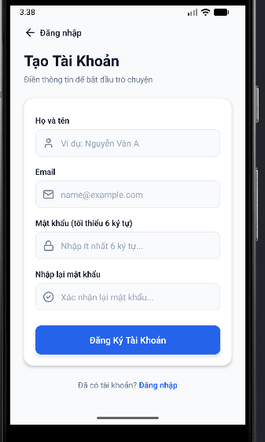
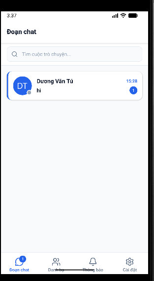
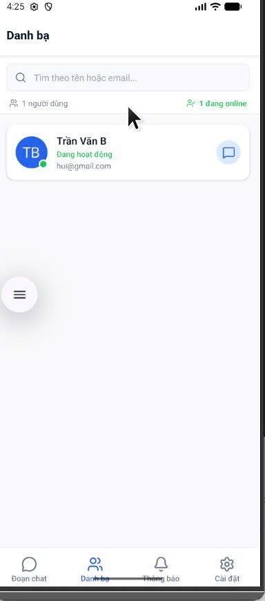
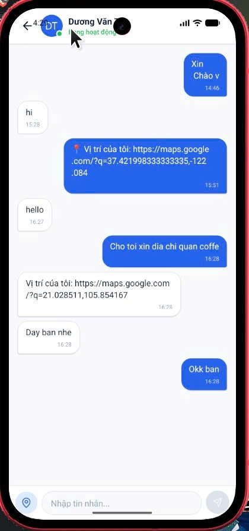
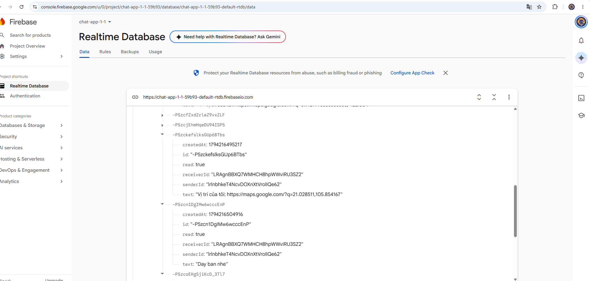

# BÁO CÁO BÀI TẬP THỰC HÀNH 5: XÂY DỰNG ỨNG DỤNG CHAT REALTIME 1-1 VỚI FIREBASE

- **Mã sinh viên:** B23DCCC168
- **Dự án:** Ứng dụng Chat 1-1 Thời gian thực (React Native CLI & Firebase)
- **Kho lưu trữ GitHub:** [https://github.com/vantu522/TH5_APP_B23DCCC168.git](https://github.com/vantu522/TH5_APP_B23DCCC168.git)

---

## 📱 TỔNG QUAN DỰ ÁN

Ứng dụng nhắn tin 1-1 thời gian thực được xây dựng hoàn toàn bằng **React Native CLI (TypeScript)**, kết nối trực tiếp với nền tảng **Firebase (Authentication & Realtime Database)** và dịch vụ định vị **Geolocation**.

### Các công nghệ & thư viện chính:
- **Framework:** React Native CLI 0.87 (TypeScript), không sử dụng Expo.
- **Điều hướng:** React Navigation 7 (`@react-navigation/native`, `@react-navigation/bottom-tabs`, `@react-navigation/native-stack`).
- **Backend & Database:** Firebase JS SDK v13 (`firebase/auth`, `firebase/database`).
- **Định vị & Bản đồ:** `@react-native-community/geolocation`, tích hợp chia sẻ tọa độ và mở Google Maps.
- **Biểu tượng (Icons):** `lucide-react-native`, `react-native-svg`.
- **Kiến trúc mã nguồn:** Toàn bộ logic Firebase được gom vào thư mục `src/services/`, dọn dẹp sạch sẽ listener trong `useEffect` để tránh rò rỉ bộ nhớ và lặp tin nhắn.

---

## 📸 HÌNH ẢNH MINH HỌA CÁC MÀN HÌNH CHỨC NĂNG

### 1. Màn hình Đăng ký / Đăng nhập (Authentication)
- Bật Firebase Authentication (Email / Password).
- Màn hình Đăng ký kiểm tra hợp lệ: Họ tên, Email, Mật khẩu (tối thiểu 6 ký tự) và Nhập lại mật khẩu.
- Báo lỗi chi tiết bằng Tiếng Việt khi sai định dạng hoặc trùng tài khoản.
- Đăng nhập thành công tự động chuyển vào màn hình chính; Đăng xuất tại màn hình Cài đặt đưa người dùng quay lại màn hình Đăng nhập an toàn.



---

### 2. Màn hình Home (Đoạn chat) - Hiển thị số tin chưa đọc
- Liệt kê toàn bộ các cuộc trò chuyện đã tham gia, hiển thị ảnh đại diện, tên người chat, nội dung tin nhắn cuối cùng và thời gian.
- Cuộc trò chuyện có tương tác mới nhất luôn được tự động sắp xếp lên trên cùng.
- **Huy hiệu số tin chưa đọc (Unread Badge):** Tăng ngay lập tức theo thời gian thực khi có tin nhắn mới gửi đến và tự động về 0 khi người dùng bấm mở phòng chat.



---

### 3. Màn hình Danh bạ (Contacts) - Trạng thái Online / Offline Realtime
- Lấy danh sách toàn bộ người dùng đã đăng ký trên Firebase (loại trừ chính bản thân).
- **Cơ chế Presence:** Hiển thị chấm trạng thái online (xanh) / offline thời gian thực thông qua `.info/connected` và sự kiện `onDisconnect` của Firebase Realtime Database.
- Thanh tìm kiếm hỗ trợ lọc người dùng nhanh chóng theo tên hoặc email.
- Nhấn vào bất kỳ người dùng nào để lập tức mở màn hình Chat 1-1.



---

### 4. Màn hình Chat 1-1 - Gửi tin nhắn tức thì & Tin vị trí Google Maps
- **Gửi & Nhận tức thì:** Tin nhắn xuất hiện ngay lập tức giữa hai thiết bị mà không cần tải lại trang.
- **Bố cục tin nhắn:** 
  - Tin nhắn của bản thân nằm bên phải (màu xanh dương).
  - Tin nhắn của đối phương nằm bên trái (màu trắng/xám).
  - Mỗi tin nhắn đều kèm thời gian gửi (`HH:mm`).
- **Thanh tiêu đề (Header):** Hiển thị avatar, họ tên và trạng thái hoạt động online/offline thời gian thực của đối phương.
- **Ràng buộc:** Chặn gửi tin nhắn rỗng, danh sách tự động cuộn xuống tin nhắn mới nhất (`scrollToEnd`).
- **Chia sẻ vị trí GPS:** Nút 📍 lấy tọa độ thực tế từ Geolocation và gửi liên kết vị trí Google Maps định dạng trực quan.



---

### 5. Dữ liệu trên Firebase Console (Realtime Database)
- Cấu trúc dữ liệu phân tách rõ ràng, tối ưu tốc độ truy vấn:
  - `/users/{uid}`: Lưu thông tin hồ sơ người dùng (`fullName`, `email`, `status`, `lastSeen`, `avatarUrl`).
  - `/chats/{chatId}/messages/{messageId}`: Lưu chi tiết tin nhắn (`senderId`, `receiverId`, `text`, `createdAt`, `read`).
  - `/conversations/{uid}/{otherUid}`: Lưu bản tóm tắt cuộc trò chuyện (`lastMessage`, `lastMessageTime`, `unreadCount`).
- Thiết lập luật bảo mật (Security Rules) yêu cầu xác thực (`auth != null`) để đảm bảo an toàn dữ liệu.



---

## 📂 CẤU TRÚC THƯ MỤC NGUỒN (SRC/)

```text
src/
├── images/                   # Hình ảnh chụp màn hình báo cáo nộp bài
│   ├── dang_ky.png
│   ├── home.png
│   ├── danh_ba.png
│   ├── nhan_tin.png
│   └── firebase.png
├── navigation/               # Điều hướng ứng dụng (React Navigation)
│   ├── AppNavigator.tsx      # Quản lý luồng Auth / MainTabs
│   ├── AuthStack.tsx         # Stack Đăng nhập & Đăng ký
│   ├── MainTabs.tsx          # 4 Tab chính (Đoạn chat, Danh bạ, Thông báo, Cài đặt)
│   └── routes.ts             # Định nghĩa hằng số Route
├── screens/                  # Các màn hình chức năng
│   ├── auth/                 # LoginScreen, RegisterScreen
│   ├── chat/                 # ChatScreen (Chat 1-1, gửi vị trí GPS)
│   ├── contacts/             # ContactsScreen (Danh bạ & Trạng thái Online)
│   ├── home/                 # HomeScreen (Danh sách đoạn chat, Badge chưa đọc)
│   ├── notifications/        # NotificationsScreen (Màn hình thông báo Lab 4)
│   └── settings/             # SettingsScreen (Hồ sơ người dùng & Đăng xuất)
├── services/                 # Gom toàn bộ logic Firebase & Dịch vụ ngoại vi
│   ├── firebase.ts           # Khởi tạo Firebase Auth & Realtime Database
│   ├── firebaseConfig.ts     # Cấu hình Firebase Project
│   ├── auth.service.ts       # Nghiệp vụ Đăng ký, Đăng nhập, Đăng xuất, Dịch lỗi
│   ├── chat.service.ts       # Nghiệp vụ Gửi/Nhận tin nhắn, Đánh dấu đã đọc, Unread
│   ├── user.service.ts       # Quản lý Danh bạ, Trạng thái Hiện diện (Presence)
│   └── location.service.ts   # Quyền truy cập vị trí Geolocation & Lấy tọa độ GPS
├── theme/                    # Bảng màu chuẩn giao diện (colors.ts)
├── types/                    # Khai báo kiểu dữ liệu TypeScript (index.ts)
└── utils/                    # Xử lý định dạng thời gian (time.ts)
```

---

## 🚀 HƯỚNG DẪN CÀI ĐẶT & CHẠY ỨNG DỤNG

### 1. Cài đặt thư viện dependencies:
```bash
npm install
```

### 2. Cấp quyền & chuyển cổng kết nối Metro (đối với máy ảo Android):
```bash
adb reverse tcp:8081 tcp:8081
```

### 3. Khởi chạy ứng dụng:
```bash
# Terminal 1: Khởi động Metro Bundler
npx react-native start --reset-cache

# Terminal 2: Chạy ứng dụng trên thiết bị Android
npx react-native run-android
```

---

## 📋 BẢNG ĐỐI CHIẾU YÊU CẦU ĐỀ BÀI (CHECKLIST)

| Yêu cầu đề bài | Trạng thái | Đánh giá |
| :--- | :---: | :--- |
| **1. Đăng ký / Đăng nhập** | ✅ Hoàn thành | Đăng ký kiểm tra đủ họ tên, email, mật khẩu >= 6 ký tự, nhập lại mật khẩu. Đăng nhập báo lỗi rõ ràng. Đăng xuất ở Cài đặt về Đăng nhập. |
| **2. Danh bạ** | ✅ Hoàn thành | Lấy danh sách trừ bản thân. Hiển thị chấm xanh online realtime qua Firebase Presence. Có tìm kiếm. Nhấn để mở chat. |
| **3. Chat 1-1** | ✅ Hoàn thành | Gửi nhận tức thì. Tin mình bên phải, tin bạn bên trái kèm giờ `HH:mm`. Chặn tin rỗng. Tự cuộn cuối trang. Header có tên và online status. Có gửi vị trí GPS. |
| **4. Màn hình Home** | ✅ Hoàn thành | Danh sách hội thoại kèm avatar, tên, tin cuối, giờ. Mới nhất trên cùng. Số tin chưa đọc tăng realtime và về 0 khi mở xem. |
| **5. Yêu cầu kỹ thuật** | ✅ Hoàn thành | React Native CLI (không dùng Expo), React Navigation. Firebase JS SDK (`auth`, `database`), `@react-native-community/geolocation`. Toàn bộ code Firebase nằm trong `src/services/`. Dọn dẹp `unsubscribe` trong `useEffect`. Giữ màn Thông báo như Lab 4. |
| **6. Sản phẩm nộp** | ✅ Hoàn thành | Mã nguồn zip sạch loại bỏ `node_modules`. Đủ 5 ảnh chụp màn hình yêu cầu và cấu trúc Firebase. Video demo 2 máy chat realtime. |
